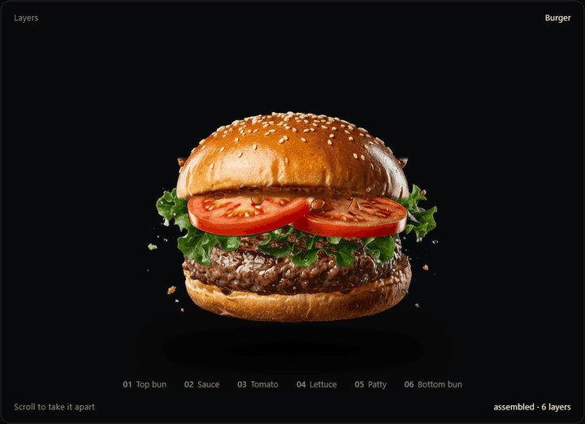

# Render

**Attach six product-layer images. Get a smooth, scroll-driven exploded view.**

Render is an installable agent skill containing a small animation engine and a local
image-to-animation helper. Phones reveal sideways; burgers and other ingredient
stacks lift vertically. Opening and closing follow scrolling, never hover or an idle tour.

The output includes a standalone HTML animation, a website embed and a ZIP. No WebGL,
paid API, account or API key is needed to build or view it.

## Burger example



Actual output from the bundled Render engine, recorded while scrolling: six PNG
layers lift apart, pause for inspection, then assemble again. The skill selected
vertical motion with a fixed camera and generated the page used for this recording.

[Source artwork, scene settings and reproduction steps](docs/examples/burger/README.md).
Burger imagery by [smford](https://github.com/smford/hamburger-decomp), licensed
[AGPL-3.0](docs/examples/burger/ARTWORK-LICENSE).

## Install

From your project, run:

```sh
npx skills add aaditya3301/render-skill --skill render
```

Choose your coding agent when prompted. For Codex specifically:

```sh
npx skills add aaditya3301/render-skill --skill render --agent codex
```

Add `-g` to install across projects. This uses the [skills installer](https://github.com/vercel-labs/skills)
(Node.js 22.20+); Render itself does not need to be published to npm.

In Codex you can alternatively ask:

```text
$skill-installer install https://github.com/aaditya3301/render-skill/tree/main/skills/render
```

If it does not appear in your skill selector, restart the agent. Skill invocation
depends on the host: Codex supports `$render`; some other agents expose `/render`.
See [OpenAI's skill documentation](https://learn.chatgpt.com/docs/build-skills).

## Use

Attach your layer files in an agent that can read files and execute local scripts, then ask:

```text
$render Turn these six burger layers into a scroll animation and give me a website embed.
```

Or use paths in your project:

```text
$render Animate the layers in ./product-layers. This is a phone; keep the surrounding website design.
```

The skill validates the files, selects motion, creates a new output directory and
returns the generated files. You can request a vertical or sideways direction explicitly.
Product-aware selection uses names and image alpha layout; the local helper is not an AI vision service.

## Image requirements

- **4–8 PNG/WebP part layers**, normally six, with a genuinely transparent background.
- **Matching canvases and an assembled position for each part.** Retain the transparent export padding.
- **Consistent camera and lighting.** Render parts from the same viewpoint.
- Number files front-to-back, or top-to-bottom for a burger: `01-top-bun.png`, `02-sauce.png`, etc.

Separate full-product photographs are not ingredient/component layers. The helper
preserves your image bytes; it does not remove backgrounds or invent missing parts.
If canvases differ, it asks for registered exports rather than guessing lost offsets.

## Build without an agent

The helper needs **Python 3.10+ and Pillow**. With [uv](https://docs.astral.sh/uv/), run:

```sh
git clone https://github.com/aaditya3301/render-skill.git
cd render-skill
uv run skills/render/scripts/render.py --input ./your-layers --output ./animation --product "Burger"
```

Without uv, install `skills/render/scripts/requirements.txt` into a local Python
environment and run the same script with its Python. The generated animation needs
neither Python nor Node to play. `--output` must be a new directory.

For attachment paths and explicit ordering, use `--images file1.png file2.png ...`.
All options and integration details are in [the usage reference](skills/render/references/usage.md).

## What you receive

| Output | Purpose |
| --- | --- |
| `index.html` | Portable animation: images and engine embedded, opens directly from disk. |
| `embed.html` | Copyable website embed. |
| `explode.js` and `layers/` | Assets to host alongside the embed. |
| `scene.json` | Editable configuration for a hosted animation. |
| `manifest.json` | Selected motion, its reason, input checksums and any warnings. |
| `render.zip` | Ready-to-share animation package, including license notices. |

For a website, copy the script and layers to public assets and paste `embed.html`,
adjusting the script URL and scene `base`. See the [integration instructions](skills/render/references/usage.md#website-integration).

## Try schematic examples

The example generator creates original, simple phone and burger layer sets:

```sh
uv run --with Pillow python examples/make_layers.py --output output/demo-layers
uv run skills/render/scripts/render.py --input output/demo-layers/burger --output output/burger --product "Burger"
uv run skills/render/scripts/render.py --input output/demo-layers/phone --output output/phone --product "Phone"
```

Open either output's `index.html` in a browser and scroll. These are schematic test
illustrations; no third-party burger photography is bundled into the skill.

## Development

```sh
python -m pip install -r requirements-dev.txt
python -m unittest discover -s tests -v
python -m playwright install chromium
python tests/browser_smoke.py
python tests/install_smoke.py
node --check skills/render/assets/explode.js
```

The browser test builds new outputs, extracts their ZIPs and verifies scroll-only
opening/reassembly, portable offline HTML, a hosted embed, keyboard selection, mobile
layout and reduced motion. It uses Playwright Chromium or an executable specified
with `CHROME_PATH`. CI runs build tests on Windows and Linux and browser tests on Linux.

## License and attribution

Render's skill and engine are [MIT licensed](LICENSE), copyright aaditya3301.
Motion behavior was inspired
by [anatomy](https://github.com/wheresryan22/anatomy); its MIT attribution is retained
in the bundled [NOTICE](skills/render/assets/NOTICE).

The burger showcase GIF and its source cutouts in `docs/examples/burger/` use the
separate [AGPL-3.0 artwork license](docs/examples/burger/ARTWORK-LICENSE). They are
documentation assets and are not included in the installed skill.

Your input artwork keeps its own license. Adjacent license/attribution files are
preserved in the generated `artwork/` folder; use `--artwork-license` and
`--artwork-credit` for notices or credits provided separately.
